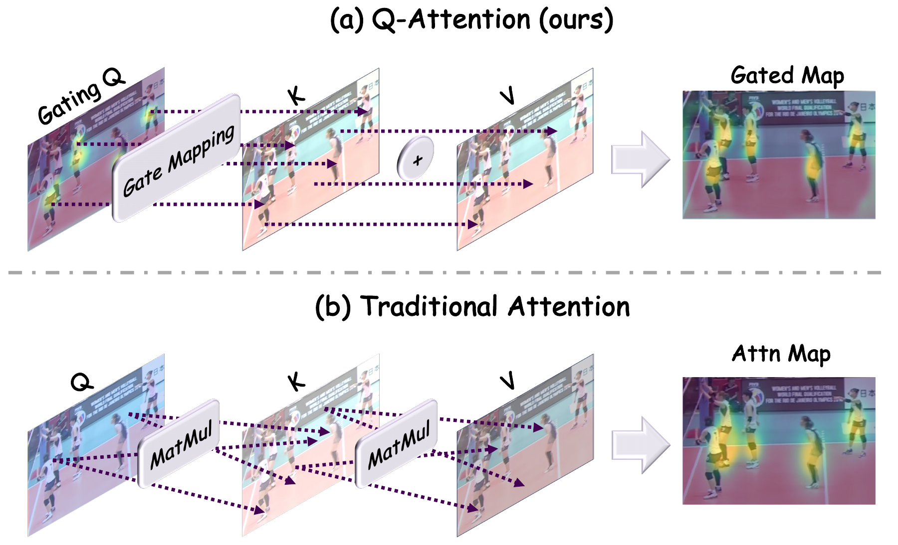
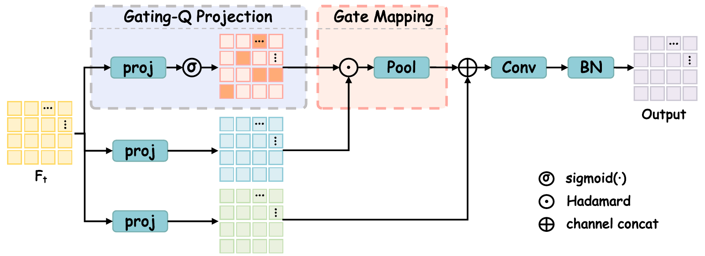

<h1 align="center">GateMOT: Q-Gated Attention<br>for Dense Object Tracking</h1>

<p align="center">
  Mingjin Lv, Zelin Liu, Feifei Shao,<br>
  Yi-Ping Phoebe Chen, Junqing Yu, Wei Yang, Zikai Song
</p>

<p align="center">
  <a href="https://arxiv.org/abs/2604.26353"></a>
</p>

<p align="center">
  <a href="#overview">Overview</a> ·
  <a href="#results">Results</a> ·
  <a href="#getting-started">Getting started</a> ·
  <a href="#citation">Citation</a>
</p>

<a id="overview"></a>

## 🔍 Overview

**GateMOT turns Query into a gate, bringing task-specific feature selection to dense tracking heads.**

Detection, motion estimation, and re-identification need different cues from the same dense feature map. Selecting those cues matters most in the decoder, where the computation budget is tight. Q-Attention makes this selection affordable: Query gates Key features directly, removing global pairwise interactions, while an ungated Value path preserves details for each task.

<p align="center">
  
</p>

- **A gate for each task.** Detection, motion, and ReID heads learn their own input-dependent feature selection.
- **A path for detail.** An ungated Value branch complements the selected Key features.
- **Built for dense maps.** The decoder avoids the quadratic spatial affinity matrix of vanilla attention.

<details>
<summary><b>A closer look at Q-Attention</b></summary>

<p align="center">
  
</p>

The selected Key features are pooled locally, concatenated with Value, and fused. See the [implementation](src/lib/model/networks/base_model.py) and [module details](docs/IMPLEMENTATION.md#q-attention).

</details>

<a id="results"></a>

## 📊 Results

Test-set results reported in the paper. MOT17 and MOT20 use private detections.

| Dataset | Backbone | HOTA ↑ | MOTA ↑ | IDF1 ↑ |
|---|---|---:|---:|---:|
| BEE24 | DLA-34 | **48.4** | 67.8 | 64.5 |
| SportsMOT | DLA-60 | **76.3** | 96.5 | 79.0 |
| MOT17 | DLA-34 | **63.3** | 78.0 | 77.9 |
| MOT20 | DLA-34 | **62.8** | 77.6 | 77.3 |

### Checkpoints

Checkpoints are available on [Google Drive](https://drive.google.com/drive/folders/1Pmd2Y_tkax5D5gQQpRpCh0YTwBl27qiD). See the [checkpoint guide](docs/MODELS.md) for filenames and inference commands.

| Dataset | Download |
|---|---|
| BEE24 | [Google Drive](https://drive.google.com/file/d/1JoFAW258G3SiDVU27-f2W3zKdSonm916/view?usp=drive_link) |
| MOT17 | [Google Drive](https://drive.google.com/file/d/1BkWeOFmDDr5b6sP5bY_k2elt8OSqb1LH/view?usp=drive_link) |
| SportsMOT | [Google Drive](https://drive.google.com/file/d/1I6cLWAVBhptTKjjuuGDeR_OvFdrCZt8E/view?usp=drive_link) |
| MOT20 | [Google Drive](https://drive.google.com/file/d/1HufLPtgFWm9_QShCzFtSZ0LukkQReSxY/view?usp=drive_link) |

The checkpoints passed strict loading and a forward check. **MOT20 is a short-training checkpoint for pipeline testing.** Full benchmark reproduction of these downloads is still being verified.

<a id="getting-started"></a>

## 🚀 Getting started

<a id="installation"></a>

### 1. Install

Use Linux with an NVIDIA GPU and a C/C++ compiler. The reference environment uses Python 3.8, PyTorch 2.4.1, torchvision 0.19.1, and CUDA 12.1.

```bash
git clone https://github.com/lvmingjin77-ui/GateMOT.git
cd GateMOT
conda create -n gatemot python=3.8 -y
conda activate gatemot
pip install torch==2.4.1 torchvision==0.19.1 --index-url https://download.pytorch.org/whl/cu121
pip install numpy==1.24.4 Cython==3.1.3 setuptools wheel
pip install -r requirements.txt

git clone https://github.com/JonathonLuiten/TrackEval.git third_party/TrackEval
git -C third_party/TrackEval checkout 12c8791b303e0a0b50f753af204249e622d0281a
```

DCN uses torchvision's implementation. For training, download the ImageNet pretrained weights from the [DLA Model Zoo](http://dl.yf.io/dla/models/imagenet/) into `pretrain/`, keeping the original filenames.

### 2. Prepare data

Download and extract the dataset you want to use. **All four main experiments train on the complete training split and evaluate on test.**

| Dataset | `DATASET` | Example `DATA_ROOT` |
|---|---|---|
| [BEE24](https://holmescao.github.io/datasets/BEE24) | `bee24` | `/path/to/BEE24` |
| [MOT17](https://motchallenge.net/data/MOT17/) | `mot17` | `/path/to/MOT17` |
| [MOT20](https://motchallenge.net/data/MOT20/) | `mot20` | `/path/to/MOT20` |
| [SportsMOT](https://github.com/MCG-NJU/SportsMOT) | `sportsmot` | `/path/to/SportsMOT/dataset` |

Each root should contain the following MOT-format directories. SportsMOT's root is the archive's `dataset/` subdirectory.

```text
DATA_ROOT/
├── train/SEQ/img1/000001.jpg
├── train/SEQ/gt/gt.txt
├── val/SEQ/...                 # SportsMOT only
├── test/SEQ/img1/000001.jpg
└── annotations/                # generated below
```

Run the command for your dataset from the repository root, replacing the example path:

```bash
DATA_ROOT=/path/to/BEE24 scripts/prepare_data.sh bee24 --splits train test
DATA_ROOT=/path/to/MOT17 scripts/prepare_data.sh mot17 --splits train test
DATA_ROOT=/path/to/MOT20 scripts/prepare_data.sh mot20 --splits train test
DATA_ROOT=/path/to/SportsMOT/dataset scripts/prepare_data.sh sportsmot --splits train val test
```

This creates `annotations/train.json` and `annotations/test.json`, plus `val.json` for SportsMOT. Images stay in place. Test conversion needs only images, not test GT. See [data format details](docs/DATA_AND_TRAINING.md#directory-layout).

<a id="training"></a>

### 3. Train

Set the dataset and root to match the data you prepared. The remaining commands work for all four datasets:

```bash
export DATASET=mot17 DATA_ROOT=/path/to/MOT17
ANN_NAME=train NUM_GPUS=2 scripts/train.sh "$DATASET"
```

The script selects DLA-34 for BEE24/MOT17/MOT20 and DLA-60 for SportsMOT. It saves checkpoints and `run_config.json` under `exp/tracking.ctdet/${DATASET}_train_qattn_s317/`. `NUM_GPUS` sets the GPU count; `GLOBAL_BATCH` sets the total batch size and must be divisible by it. Default schedules are listed in [training settings](docs/DATA_AND_TRAINING.md#training-settings).

If training is interrupted, resume the same run with:

```bash
ANN_NAME=train NUM_GPUS=2 scripts/train.sh "$DATASET" \
  --resume --load_model "exp/tracking.ctdet/${DATASET}_train_qattn_s317/model_last.pth"
```

### 4. Track the test split

For a model trained with the commands above, choose its checkpoint and a fresh results directory. For a downloaded checkpoint, use the [matching commands](docs/MODELS.md#run-the-checkpoints).

```bash
export LOAD_MODEL=exp/tracking.ctdet/${DATASET}_train_qattn_s317/model_last.pth
if [ "$DATASET" = sportsmot ]; then
  export LOAD_MODEL=exp/tracking.ctdet/sportsmot_train_qattn_s317/model_70.pth
fi
export TRACKERS_FOLDER=results/${DATASET}_test
SPLIT=test scripts/test.sh "$DATASET" --output_dir "$TRACKERS_FOLDER"
```

This example uses the last checkpoint for BEE24/MOT17/MOT20 and epoch 70 of the SportsMOT 80-epoch schedule. Use the checkpoint guide for downloaded weights. Tracking writes one MOT-format `.txt` file per sequence to `TRACKERS_FOLDER`.

### 5. Evaluate

Local evaluation requires `test/SEQ/gt/gt.txt`. If test GT is available, keep the dataset, root, and results directory set above and compute HOTA, MOTA, and IDF1:

```bash
SPLIT=test scripts/eval_hota.sh
```

Hidden test splits can be tracked without GT, but their scores require the benchmark's evaluation service or released annotations. Metrics are saved under `${TRACKERS_FOLDER}_eval_test/trackers/`. Use fresh tracking and evaluation directories for each run. To rerun metrics alone, set `EVAL_DIR` to a new directory. See [evaluation details](docs/DATA_AND_TRAINING.md#evaluation).

<a id="validation"></a>

### When should train be split in half?

**Use half-splits for development when there is no official validation set:** local validation, hyperparameter or checkpoint selection, and ablation studies. For BEE24, MOT17, and MOT20, the first `floor(N/2)` frames of each training sequence form `halftrain`; the remaining frames form `halfval`. Once settings are fixed, train a separate model on **full train** for the main test experiment. A full-training model evaluated on its own second half is not held-out validation.

**SportsMOT already has an official val split**, so use that directly. Neither validation protocol uses test results to choose settings. The main experiments above do not require temporal splitting.

<details>
<summary><b>Half-training and half-validation commands — BEE24 / MOT17 / MOT20</b></summary>

Prepare the halves for your dataset. These commands need only `train/` and leave the images in place:

```bash
DATA_ROOT=/path/to/BEE24 scripts/prepare_data.sh bee24 --splits halftrain halfval
DATA_ROOT=/path/to/MOT17 scripts/prepare_data.sh mot17 --splits halftrain halfval
DATA_ROOT=/path/to/MOT20 scripts/prepare_data.sh mot20 --splits halftrain halfval
```

Then train and validate. Change `DATASET` and `DATA_ROOT` for BEE24 or MOT20:

```bash
export DATASET=mot17 DATA_ROOT=/path/to/MOT17
ANN_NAME=halftrain NUM_GPUS=2 scripts/train.sh "$DATASET"

export LOAD_MODEL=exp/tracking.ctdet/${DATASET}_halftrain_qattn_s317/model_last.pth
export TRACKERS_FOLDER=results/${DATASET}_halfval
SPLIT=halfval scripts/test.sh "$DATASET" --output_dir "$TRACKERS_FOLDER"
SPLIT=halfval scripts/eval_hota.sh
```

The `_halftrain_` experiment directory keeps this model separate from the full-training model. Replace `model_last.pth` with a numbered checkpoint to validate another epoch, using a new results directory. If resuming this run, keep `ANN_NAME=halftrain` and load its own checkpoint.

</details>

<details>
<summary><b>Official validation commands — SportsMOT</b></summary>

Prepare the official train/val splits, then train if you do not already have a model from the official training split:

```bash
export DATASET=sportsmot DATA_ROOT=/path/to/SportsMOT/dataset
scripts/prepare_data.sh "$DATASET" --splits train val
ANN_NAME=train NUM_GPUS=2 scripts/train.sh "$DATASET"
```

Validate a checkpoint using the official val images and GT:

```bash
export LOAD_MODEL=exp/tracking.ctdet/sportsmot_train_qattn_s317/model_70.pth
export TRACKERS_FOLDER=results/sportsmot_val
SPLIT=val scripts/test.sh "$DATASET" --output_dir "$TRACKERS_FOLDER"
SPLIT=val scripts/eval_hota.sh
```

</details>

<details>
<summary><b>Optional — visualize an image sequence</b></summary>

```bash
DEMO=/path/to/SEQ/img1 LOAD_MODEL=/path/to/model.pth ARCH=dla34 \
  scripts/demo.sh --exp_id demo_mot17
```

Set `ARCH` and any additional model options according to the [checkpoint guide](docs/MODELS.md#run-the-checkpoints). This example saves the video to `results/demo_mot17_img1.avi` and rendered frames to `results/demo*.jpg`.

</details>

## Documentation

| Topic | Guide |
|---|---|
| Checkpoint downloads and matching inference commands | [Checkpoints](docs/MODELS.md) |
| Data preparation, training, and evaluation | [Data and training](docs/DATA_AND_TRAINING.md) |
| Q-Attention, losses, and association | [Implementation](docs/IMPLEMENTATION.md) |
| Train/resume/inference checks | [Software validation](docs/VALIDATION.md) |

## Acknowledgements

Built on [CenterTrack](https://github.com/xingyizhou/CenterTrack), [DLA](https://github.com/ucbdrive/dla), [FairMOT](https://github.com/ifzhang/FairMOT), and [ByteTrack](https://github.com/FoundationVision/ByteTrack). We thank their authors for sharing their work. See [LICENSE](LICENSE) and [NOTICE](NOTICE).

## Citation

If you find GateMOT useful in your research, please cite:

```bibtex
@misc{lv2026gatemot,
  title         = {{GateMOT}: {Q}-Gated Attention for Dense Object Tracking},
  author        = {Lv, Mingjin and Liu, Zelin and Shao, Feifei and Chen, Yi-Ping Phoebe and Yu, Junqing and Yang, Wei and Song, Zikai},
  year          = {2026},
  eprint        = {2604.26353},
  archivePrefix = {arXiv},
  primaryClass  = {cs.CV},
  url           = {https://arxiv.org/abs/2604.26353}
}
```
